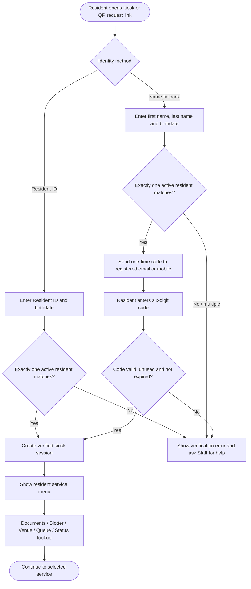
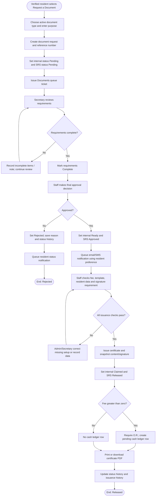
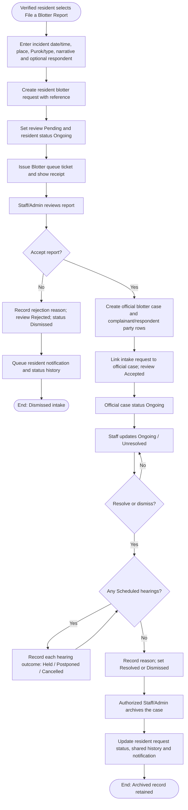
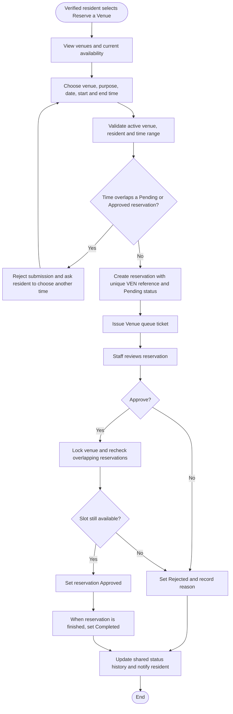
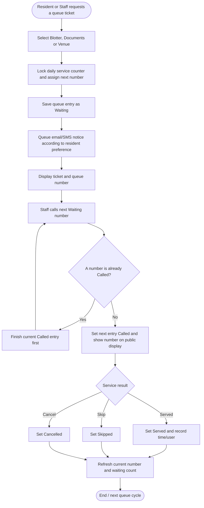

# BRMS Business Process Model and Notation (BPMN) — Revised SRS Branch

**Repository:** `sachie34/Birms`  
**Code baseline:** `john/msit-srs-compliance`  
**Editable BPMN source:** `BRMS_BPMN.bpmn` (BPMN 2.0 XML with diagram layout)  
**Application source checked:** kiosk, queue, documents, resident-blotter intake, blotter/hearing, venue, tracker, notification and certificate routes/libraries.

> These workflows are based on the newer MSIT-SRS-compliance branch. They include kiosk/QR identity verification, three service queues, venue reservations and the shared status tracker. Do not use the older `main`-branch diagrams for this version of the system.

## 1. Resident kiosk identity verification and service selection

- Direct verification uses Resident ID plus birthdate.
- Fallback verification uses first name, last name and birthdate, then a one-time code sent to the registered contact channel.
- Kiosk identity attempts are rate-limited. The verified kiosk session expires after 90 seconds of inactivity.
- A resident can only use the self-service flow when the resident record is active and not archived.

## 2. Document request and certificate issuance

**Important status distinction:** The application keeps internal workflow statuses (`Pending`, `Review`, `Ready`, `Claimed`, `Rejected`, `Cancelled`) and a separate revised-SRS public status (`Pending`, `Approved`, `Rejected`, `Released`). The unified tracker and resident status lookup use the revised-SRS status.

- Secretary/Admin performs the requirements review; Staff/Admin performs the final request decision and certificate issuance according to the permission map.
- Certificate issuance is blocked if requirements are not complete, the fee or wording is not configured, required resident details are missing, or a required Chairman signature image is unavailable.
- The Admin-managed Chairman signature image is applied automatically when the document type requires it and is snapshotted with the issuance.
- Paid issuance requires an O.R. number and creates a pending cash-ledger row. A zero-fee issuance does not create a ledger row.
- The certificate layout is still marked as a draft pending official layout approval; printing a PDF does not mean the official barangay format has been approved.

## 3. Resident-submitted blotter report and official case workflow

- The resident-submitted intake is stored separately in `resident_blotter_requests`.
- Staff/Admin accepts or rejects the intake. Accepting it creates the official `blotters` record and party rows; rejecting it leaves the intake in history and marks its public status Dismissed.
- Official case statuses are `Ongoing`, `Unresolved`, `Resolved`, `Dismissed`, and `Archived`.
- Hearing scheduling is tracked separately. A hearing can be marked `Held`, `Postponed`, or `Cancelled`; this does not automatically change the five-state blotter case status.
- A case cannot be resolved, dismissed or archived while it has a Scheduled hearing. Resolved/Dismissed cases can then be archived; blotter records are protected from deletion.

## 4. Venue reservation workflow

- Pending and Approved reservations both block overlapping time slots.
- Approval performs a second overlap check while locking the venue to protect against simultaneous approvals.
- Live availability is green/Available or red/In Use. Staff can also set an explicit availability override.
- Reservation statuses are `Pending`, `Approved`, `Rejected`, and `Completed`.

## 5. Service queue workflow

- Each of the three services has a separate daily counter and queue sequence.
- Only one queue entry per service/day may be in the Called state at a time.
- Staff can issue a ticket, call next, mark served, skip or cancel. The public display exposes queue numbers and waiting counts, not resident personal information.
- Queue notifications are placed in the email/SMS outboxes according to the resident's saved preference; outbox creation alone does not guarantee delivery.

## 6. Unified tracker and resident status lookup

The Staff/Admin All Services Tracker combines document requests, resident blotter reports/official cases and venue reservations. The kiosk status lookup accepts a reference number and displays the service, current SRS status, submitted time and available status history. It does not display resident personal details.

## 7. Role lanes / responsibility summary

| Internal role | Revised SRS role | Main workflow responsibilities |
|---|---|---|
| `admin` | Admin | System setup, users, settings, queue/venue controls, all service actions, signature image configuration and audit. |
| `clerk` | Staff | Resident-facing service processing, final document decisions and issuance, queue handling, venue decisions and blotter intake review. |
| `secretary` | Secretary | Resident/document/blotter record maintenance, document requirements review and hearing/case support. |
| `captain` | Chairman / Punong Barangay | Read-only access to records, tracker, hearings, queue, venues, reports and cash ledger. The stored signature is applied by Staff; Chairman does not approve or edit records in the current permission map. |

## 8. Notation and implementation boundary

The Mermaid diagrams in this file are readable workflow overviews. The editable BPMN 2.0 XML file contains the principal service processes for import into a BPMN editor. This documentation reflects source code and migrations on `john/msit-srs-compliance`; it does not by itself prove that the user's local XAMPP database has applied every migration or that external email/SMS delivery is configured and successful.
