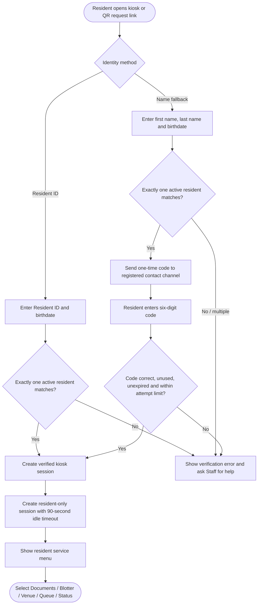
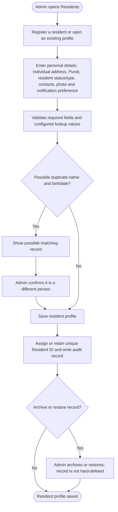
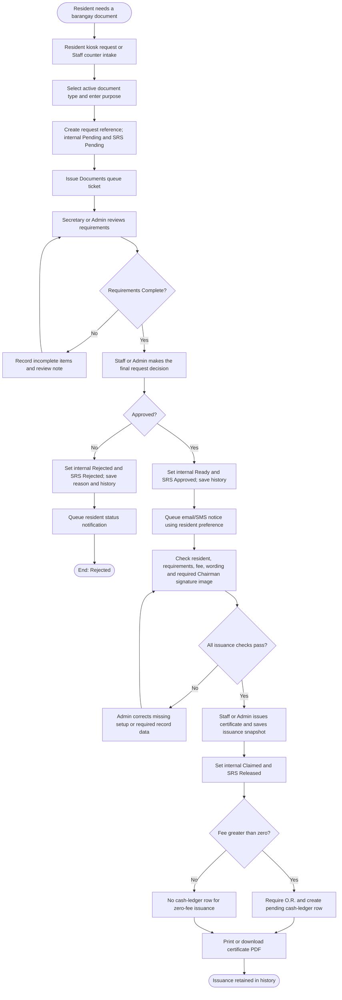
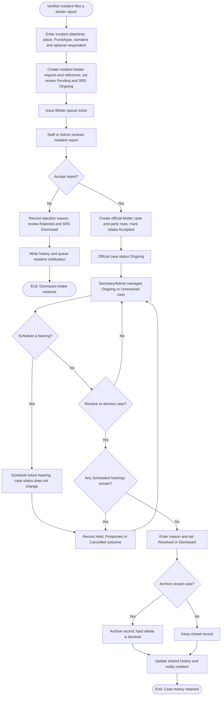
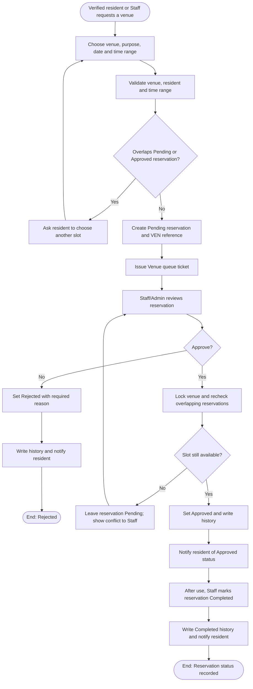
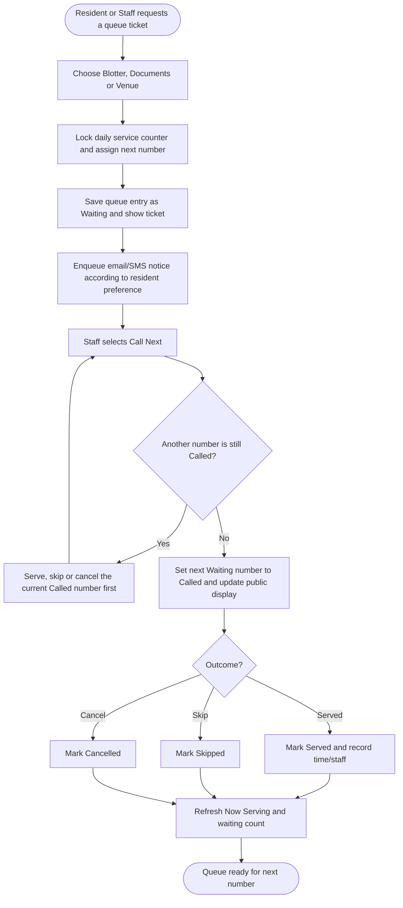

# BRMS Business Process Model and Notation (BPMN) — Revised SRS Branch

**Repository:** `sachie34/Birms`  
**Code baseline:** `john/msit-srs-compliance`  
**Editable BPMN source:** `BRMS_BPMN.bpmn` (BPMN 2.0 XML with diagram layout)  
**Application source checked:** resident profile, kiosk identity, document request, certificate, resident blotter, official blotter/hearing, venue, queue, unified tracker, status lookup, and notification code.

> This documentation describes the newer MSIT-SRS-compliance branch. It is intentionally tied to that branch rather than the older `main` version. The BPMN file contains seven separate process diagrams so the resident-facing and staff-facing workflows stay readable.

## 1. Resident kiosk identity verification and service selection

- Direct identity checking uses Resident ID plus birthdate and must match exactly one active, non-archived resident.
- The fallback uses first name, last name and birthdate. If exactly one resident matches, the system sends a one-time verification code using a configured email or SMS channel.
- The one-time code expires after five minutes and allows at most five attempts. Identity and code requests are rate-limited.
- The kiosk session is resident-only and ends after 90 seconds of inactivity. Residents without a usable registered contact channel are directed to Staff for counter assistance.

## 2. Resident record registration and maintenance

- Resident profiles use an individual address and Purok, resident status, resident type, marital status, contact details, optional photo and notification preference.
- The system assigns a unique Resident ID when a new profile is saved. A possible duplicate name and birthdate requires the Admin to confirm that the records are different people.
- In the current permission map, resident creation, editing, archiving and restoring are Admin functions. Staff, Secretary and Chairman have view access.
- **CSV import is not shown as an active process:** the current `public/residents/import.php` route is retired/disabled in this branch and redirects with a warning. A leftover import helper must not be presented as a working user-facing import feature.

## 3. Document request and certificate issuance

**Important status distinction:** The application retains internal workflow statuses (`Pending`, `Review`, `Ready`, `Claimed`, `Rejected`, `Cancelled`) and a revised-SRS public status (`Pending`, `Approved`, `Rejected`, `Released`). The unified tracker and resident status lookup use the revised-SRS status.

- Secretary/Admin performs the requirements review. Staff (internal role `clerk`) or Admin makes the final decision and issues the certificate.
- Issuance is blocked until requirements are Complete and the required resident data, document wording, fee and any required Chairman signature image are available.
- The Chairman signature image is maintained by Admin. When a document type requires it, the image is applied automatically and its path is snapshotted with the issuance.
- A paid issuance requires an O.R. number and creates a pending cash-ledger row. A zero-fee issuance does not create a ledger row.
- The certificate output is marked as a draft pending official layout approval. A working PDF output does not mean the official barangay certificate format has been approved.
- Email/SMS notifications depend on resident contact details and the corresponding provider being configured and enabled. An outbox record is not proof that a message reached the resident.

## 4. Resident-submitted blotter report, official case and hearing workflow

- Kiosk-submitted reports are first stored in `resident_blotter_requests`. Staff/Admin may accept or reject the intake. Accepting creates the official `blotters` record and complainant/respondent party rows; rejecting retains the intake and sets its resident-facing status to Dismissed.
- Official case statuses are `Ongoing`, `Unresolved`, `Resolved`, `Dismissed`, and `Archived`.
- Staff/Admin reviews the resident-submitted intake. Secretary/Admin maintains the official blotter case and schedules/records hearings under the current permission map.
- Hearing scheduling is separate from the five-state case status. Recording `Held`, `Postponed` or `Cancelled` does not automatically change the case status.
- The system does not allow a case to be Resolved, Dismissed or Archived while a hearing is still Scheduled. Resolved and Dismissed cases can be archived; a database trigger prevents hard deletion.

## 5. Venue reservation workflow

- Both Pending and Approved reservations block overlapping time slots.
- The second overlap check runs while the venue is locked. If a conflict is found at approval time, the action is refused and the reservation remains **Pending**; the code does not silently mark it Rejected.
- Availability is calculated from approved reservations unless Staff sets a manual override. Green means Available; red means In Use.
- Reservation statuses are `Pending`, `Approved`, `Rejected` and `Completed`. Notifications are attempted after saved status changes, subject to configured email/SMS services.

## 6. Three separate daily service queues

- Each service has its own daily number sequence: Blotter, Documents and Venue.
- Only one queue entry per service/day may be in the Called state at a time. Staff must finish the current Called number before calling another.
- `Served` applies to a Called entry; `Skipped` and `Cancelled` can apply to Waiting or Called entries. Queue statuses are `Waiting`, `Called`, `Served`, `Skipped` and `Cancelled`.
- The public queue display shows current numbers and waiting counts, not residents' personal information. It refreshes automatically.
- Queue notices use the resident's notification preference where a resident is linked. Walk-in tickets without a resident link do not have a resident notification destination.

## 7. Unified tracker and resident status lookup

The Staff/Admin All Services Tracker combines document requests, resident blotter reports/official cases and venue reservations. A resident may enter a reference number at the kiosk to check a document, venue, resident-blotter request or official blotter case.

The public lookup is rate-limited and displays only the service, reference, current public status, submission time and available status history. It does not display resident personal details.

## 8. Role responsibilities represented by the workflows

| Internal account role | Revised SRS role | Responsibilities shown in these processes |
|---|---|---|
| `admin` | Admin | Resident profile maintenance, system settings, user accounts, Chairman signature setup, all service actions, queues, venues and audit/backup controls. |
| `clerk` | Staff | Resident-facing service intake, document final decisions and issuance, resident blotter intake review, queue operations and venue reservation management/decisions. |
| `secretary` | Secretary | Document requirements review; official blotter case maintenance, hearings and case archive actions. Resident records are view-only for this role in the current permission map. |
| `captain` | Chairman / Punong Barangay | Read-only access to records, tracker, hearings, queues, venues, reports and cash ledger. The stored signature is applied by Staff; Chairman does not approve or edit records in the current permission map. |

## 9. Notation and implementation boundary

The editable file `BRMS_BPMN.bpmn` contains seven BPMN 2.0 process diagrams: resident record maintenance, kiosk identity verification, document requests/certificate issuance, resident blotter intake and case/hearing handling, venue reservations, queue management, and status lookup.

The diagrams document the repository branch, not the state of an individual XAMPP installation. Before submitting or presenting, confirm that the local database migration check reports no pending migrations, that the app is running from this same branch, and that external email/SMS providers are configured before claiming live message delivery. The legacy Visitor Logbook table/route may remain for compatibility; it is not shown as a revised-SRS kiosk service.

## 10. Repository files used to verify the BPMN steps

- Resident profiles: `public/residents/form.php`, `public/residents/action.php`, `app/permissions.php`.
- Kiosk identity and resident session: `public/kiosk/index.php`, `public/kiosk/identify.php`, `public/kiosk/verify.php`, `app/kiosk_lib.php`.
- Documents and certificates: `public/kiosk/request.php`, `public/requests/action.php`, `public/requests/form.php`, `public/certificates/issue.php`, `app/requests_lib.php`, `app/certificates_lib.php`, `app/signature_lib.php`.
- Resident blotter intake and official case/hearing handling: `public/kiosk/blotter.php`, `public/blotter_requests/index.php`, `public/blotter_requests/action.php`, `public/blotters/action.php`, `public/blotters/hearing_action.php`, `app/blotter_requests_lib.php`, `app/blotters_lib.php`.
- Venues and queues: `public/kiosk/venue.php`, `public/venues/index.php`, `public/venues/action.php`, `public/kiosk/queue.php`, `public/queue/index.php`, `public/queue/action.php`, `public/queue/display.php`, `app/venues_lib.php`, `app/queue_lib.php`.
- Tracker and public status: `public/requests/all.php`, `public/kiosk/status.php`.
- Notifications and role definitions: `app/notifications_lib.php`, `app/email_provider.php`, `app/permissions.php`, `app/menu.php`.
