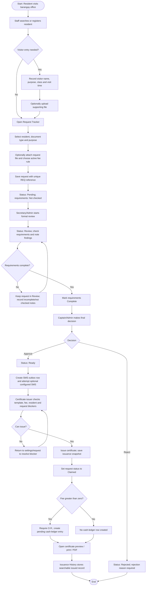
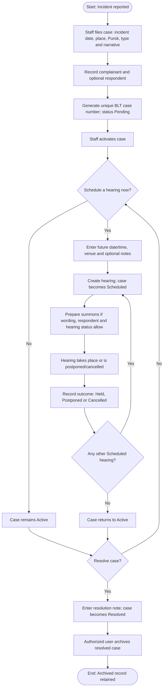

# BRMS Business Process Model and Notation (BPMN)

**Process model:** Current implemented BRMS workflows  
**Repository baseline:** `sachie34/Birms`, branch `main`  
**Editable diagrams:** `BRMS_BPMN.bpmn` (document request and certificate issuance, BPMN 2.0 XML) and `BRMS_Blotter_Process.bpmn` (blotter and hearing process, BPMN 2.0 XML)  
**Scope:** Visitor intake, resident/document request processing, certificate issuance and cash recording, plus the separate blotter/hearing workflow.

> This diagram describes the routes and PHP business rules currently present in the repository. It does not depict the revised-SRS queue/kiosk, venue reservation, or email features because those are not implemented in the current code.

## 1. Document request and certificate issuance workflow

### Document request statuses and role boundaries

| Step | Current implemented behavior |
|---|---|
| Intake | A permitted staff account creates a request for a resident. A visitor entry can optionally be linked. New requests start as `Pending` with requirements `Not checked`. |
| Formal review | Secretary or Administrator moves a request to `Review` and records the requirements status. Editing material request details resets the requirements check. |
| Final decision | Captain or Administrator may move a reviewed request to `Ready` or `Rejected`, but only when requirements are `Complete`. Rejection requires a reason. |
| Notification | When a request becomes `Ready`, the system writes an SMS outbox record and attempts sending only if an SMS provider is configured and enabled. Provider delivery is not guaranteed by creating the outbox record. |
| Issuance | Secretary or Administrator can issue only a `Ready` request after requirements, configured fee, document wording and required resident details pass validation. |
| Completion | Issuance is saved once per request, the request becomes `Claimed`, and a cash-ledger row is created only when the fee is greater than zero. |
| Print / PDF | The issued certificate can be previewed; printing/PDF download are permission-controlled. The displayed certificate is explicitly marked draft pending official layout approval. |

**Request status values in code:** `Pending`, `Review`, `Ready`, `Claimed`, `Rejected`, `Cancelled`. `Cancelled` is a permitted cancellation from Pending or Review. The BPMN's main path shows the usual successful route; cancellation is an alternate stop outcome.

## 2. Blotter and hearing workflow

### Blotter and hearing rules

- A case starts as `Pending`; it can move to `Active` or `Resolved`.
- Scheduling a hearing changes the case to `Scheduled`.
- A hearing outcome is one of `Held`, `Postponed`, or `Cancelled`. Postponed and Cancelled require a reason.
- When the last scheduled hearing receives an outcome, the case returns to `Active`.
- A case can be resolved only after all scheduled hearings have outcomes and a resolution note is supplied.
- Only resolved cases can be archived; archived cases can be restored. Case and party records are not hard-deleted.
- Summons printing is blocked until the official summons wording is configured, a respondent exists, and the hearing is still Scheduled.

## 3. Supporting resident and visitor processes

- **Resident maintenance:** authorized staff add/edit resident records, optionally create or select a household, and use configured Purok/category/employment lookups. Duplicate name + birthdate is flagged for confirmation. Residents may be archived/restored rather than deleted.
- **Verification:** authorized staff manually record identity checks using a government ID/other document, or voter-registration checks against the barangay voter list. This is a manual log only; the application does not contact COMELEC or another external verification database.
- **Visitor Logbook:** staff record visitor name, purpose, visit classification and timestamp, with optional PDF/JPG/PNG attachment. A saved visitor entry can be used to start a document request.
- **Cash ledger:** paid issuances create a pending ledger entry. Authorized administrators manage ledger details and reconciliation; the Captain role has view-only permission in the current permission map.
- **Audit:** significant operations write audit records with actor snapshot, action, module, status and remarks.

## 4. Not represented as implemented

Do not include these as live BRMS process steps in this submission: public kiosk/QR request intake, queue number generation, call-next/served/skip/cancel queue controls, separate Documents/Blotter/Venue queues, venue inventory/reservation and conflict checking, email notifications, or automated external resident/voter database verification. The repository routes/schema reviewed do not implement those workflows.

## 5. Files reviewed

`app/menu.php`, `app/permissions.php`, `app/requests_lib.php`, `app/certificates_lib.php`, `app/blotters_lib.php`, `app/residents_lib.php`, `app/attachments_lib.php`; the corresponding `public/requests`, `public/certificates`, `public/residents`, `public/visitors`, `public/blotters` routes; and database migrations 001–012.

**Verification boundary:** The model is based on checked-in source code and migrations on `main`. It is not a claim that every workflow has been re-tested against the user's local XAMPP database during this documentation update.
