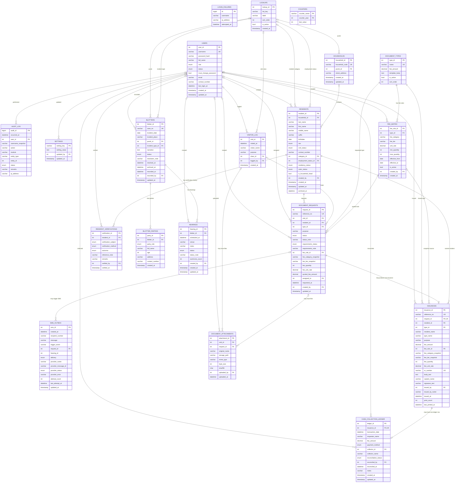

# BRMS Entity Relationship Diagram (ERD)

**Repository checked:** `sachie34/Birms`  
**Baseline:** `main`, database migrations `001_core.sql` through `012_sms_provider.sql`, plus the PHP pages and libraries that read/write these tables.  
**Purpose:** Document the database that the current application actually uses. This is an implementation ERD, not a proposed future schema.

> **Scope note:** The current code uses household-based resident addresses and includes a Visitor Logbook. It does not implement the revised-SRS queue/kiosk or venue-reservation modules. Those are intentionally not added to this ERD.

## 1. ERD diagram

## 2. Relationship and cardinality notes

| Parent | Child | Cardinality | Meaning in this application |
|---|---|---:|---|
| HOUSEHOLDS | RESIDENTS | 1 to 0..many | A household may contain multiple resident records; a resident may have no household assigned. |
| RESIDENTS | DOCUMENT_REQUESTS | 1 to many | Each request belongs to one resident. |
| VISITOR_LOG | DOCUMENT_REQUESTS | 1 to 0..many | A request may optionally be linked to a visitor entry. |
| DOCUMENT_TYPES | DOCUMENT_REQUESTS | 1 to many | Each request selects one configured document type. |
| DOCUMENT_REQUESTS | ISSUANCES | 1 to 0..1 | A request can produce at most one issuance; `issuances.request_id` is unique. |
| ISSUANCES | CASH_COLLECTION_LEDGER | 1 to 0..1 | An issuance can have at most one ledger row; the application creates one when the fee is greater than zero. |
| BLOTTERS | BLOTTER_PARTIES | 1 to many | A case has complainant/respondent party records. |
| BLOTTERS | HEARINGS | 1 to many | A case may have multiple scheduled or completed hearings. |
| RESIDENTS | RESIDENT_VERIFICATIONS | 1 to many | Manual identity/voter-list verification history is retained. |
| VISITOR_LOG / DOCUMENT_REQUESTS | DOCUMENT_ATTACHMENTS | 1 to many each | Files are attached to either a visitor entry or a request; application code inserts one owner column per attachment. |
| DOCUMENT_REQUESTS | SMS_OUTBOX | 1 to many | A request can have notification log entries; the current ready event writes an outbox record. |

**Optional foreign keys:** A nullable user reference means a record can remain if the related user is later removed; the foreign key uses `ON DELETE SET NULL`. Lookup references are shared by `list_key` (for example, `purok`, `resident_category`, `employment_status`, `visit_class`, and `incident_type`).

**Special cases:** `AUDIT_LOG.entity_type/entity_id` is a polymorphic audit reference, not a database foreign key to every business table. `COUNTERS` uses the composite primary key `(counter_name, counter_year)`. `LOGIN_FAILURES` is an independent sign-in security log. `SETTINGS` is a key/value table.

## 3. Actual application modules represented

- Accounts, login protection, role-based access and audit trail.
- Barangay settings, configured document types, lookup lists and running counters.
- Resident and household registration, resident search/filter, CSV import/export, archive/restore and manual identity/voter-registration verification.
- Visitor Logbook with visit classification and private attachments.
- Document request intake, assignment, requirements review, final decision, status tracking and request attachments.
- Configurable fee matrix and saved fee quotes.
- Certificate generation, print/PDF preview, issuance history and O.R. tracking.
- Cash collection ledger and reconciliation.
- Blotter case intake, complainant/respondent records, status changes, case archive/restore, hearings and summons.
- SMS outbox and optional provider delivery tracking.

## 4. Deliberate exclusions (not implemented in this repository baseline)

The following entities are **not** present in migrations 001–012 and are not represented as working modules in the current PHP routes: queue entries/call-next/served/skip, public kiosk/QR queue flow, venue inventory, venue reservations and reservation conflict handling, and email notification delivery. Do not add them to the submitted implementation ERD unless those features are implemented and tested in the application.

## 5. Source files reviewed

- `app/menu.php`, `app/permissions.php`
- `app/residents_lib.php`, `app/requests_lib.php`, `app/certificates_lib.php`, `app/blotters_lib.php`, `app/attachments_lib.php`
- `public/residents/*`, `public/visitors/index.php`, `public/requests/*`, `public/certificates/*`, `public/blotters/*`, `public/admin/ledger.php`, `public/admin/sms.php`
- `database/migrations/001_core.sql` through `012_sms_provider.sql`

**Verification boundary:** This ERD is based on the checked-in schema and the application SQL paths. A live database export from the user's XAMPP instance was not available in this review, so local-only schema changes are not included.
