# BRMS Entity Relationship Diagram (ERD) — Revised SRS Branch

**Repository:** `sachie34/Birms`  
**Code baseline:** `john/msit-srs-compliance`  
**Schema source:** `database/expected_schema.json` and migrations `001`–`018` on that branch.  
**Application source checked:** `app/menu.php`, `app/permissions.php`, queue/kiosk/venue/notification/signature libraries, and their corresponding `public/` routes.

> This is the ERD for the newer MSIT-SRS-compliance branch. It includes the implemented database entities for resident self-service, queues, venue reservations, revised request tracking and notifications. It is not the ERD for the older `main` branch.

## Full database ERD

The diagram below is generated from the branch's expected schema: entity attributes are the recorded columns, and PK/FK/UK markers identify primary, foreign and unique keys.

```mermaid
erDiagram
    AUDIT_LOG {
      bigint audit_id PK,UK
      datetime occurred_at
      int user_id FK
      varchar username_snapshot
      varchar action
      varchar module
      varchar entity_type
      int entity_id
      enum status
      varchar remarks
      varchar ip_address
    }
    BLOTTER_PARTIES {
      int party_id PK,UK
      int blotter_id FK
      enum party_role
      varchar full_name
      tinyint age
      varchar address
      varchar contact_number
      timestamp created_at
    }
    BLOTTERS {
      int blotter_id PK,UK
      varchar case_no UK
      date incident_date
      time incident_time
      varchar incident_place
      int purok_id FK
      text narrative
      enum status
      varchar resolution_note
      datetime resolved_at
      datetime archived_at
      datetime recorded_at
      int recorded_by FK
      timestamp updated_at
      int incident_type_id FK
      enum msit_status
      enum archived_from_status
    }
    CASH_COLLECTION_LEDGER {
      int ledger_id PK,UK
      int issuance_id FK,UK
      datetime transaction_date
      varchar requester_name
      decimal fee_amount
      enum payment_method
      int collector_id FK
      varchar collector_name
      enum reconciliation_status
      int reconciled_by FK
      datetime reconciled_at
      varchar notes
      timestamp created_at
      timestamp updated_at
    }
    COUNTERS {
      varchar counter_name PK
      smallint counter_year PK
      int last_value
    }
    DOCUMENT_ATTACHMENTS {
      int attachment_id PK,UK
      int visit_id FK
      int request_id FK
      varchar original_name
      varchar storage_path
      varchar mime_type
      int byte_size
      char sha256
      int uploaded_by FK
      datetime uploaded_at
    }
    DOCUMENT_REQUESTS {
      int request_id PK,UK
      varchar reference_no UK
      int visit_id FK
      int resident_id FK
      int type_id FK
      varchar purpose
      enum status
      varchar status_note
      int assigned_to FK
      datetime requested_at
      int created_by FK
      timestamp updated_at
      enum requirements_status
      varchar requirements_note
      int fee_rule_id FK
      varchar fee_category_snapshot
      varchar fee_tier_snapshot
      int fee_quantity
      decimal fee_unit_rate
      decimal quoted_fee_amount
      enum msit_status
    }
    DOCUMENT_TYPES {
      int type_id PK,UK
      varchar name UK
      decimal fee_amount
      text template_body
      tinyint is_active
      tinyint requires_chairman_signature
      int sort_order
    }
    FEE_MATRIX {
      int fee_rule_id PK,UK
      int type_id FK
      varchar fee_category
      varchar fee_tier
      decimal unit_rate
      int min_quantity
      int max_quantity
      date effective_from
      date effective_to
      tinyint is_active
      int created_by FK
      timestamp created_at
    }
    HEARINGS {
      int hearing_id PK,UK
      int blotter_id FK
      datetime scheduled_at
      varchar venue
      varchar notes
      enum status
      varchar status_note
      int summons_count
      int created_by FK
      timestamp created_at
      timestamp updated_at
    }
    HOUSEHOLDS {
      int household_id PK,UK
      varchar household_code UK
      int purok_id FK
      varchar street_address
      timestamp created_at
      timestamp updated_at
    }
    ISSUANCES {
      int issuance_id PK,UK
      varchar reference_no UK
      int request_id FK,UK
      int resident_id FK
      int type_id FK
      varchar resident_name
      varchar type_name
      varchar purpose
      decimal fee_amount
      varchar or_number UK
      text body_text
      varchar captain_name
      int issued_by FK
      varchar issued_by_name
      datetime issued_at
      int print_count
      datetime last_printed_at
      int fee_rule_id FK
      varchar fee_category_snapshot
      varchar fee_tier_snapshot
      int fee_quantity
      decimal fee_unit_rate
      varchar signature_text
      varchar chairman_signature_path
    }
    LOGIN_FAILURES {
      bigint id PK,UK
      varchar username
      varchar ip_address
      datetime attempted_at
    }
    LOOKUPS {
      int lookup_id PK,UK
      varchar list_key
      varchar label
      int sort_order
      tinyint is_active
      timestamp created_at
    }
    NOTIFICATION_OUTBOX {
      bigint notification_id PK,UK
      int resident_id FK
      enum channel
      varchar recipient
      varchar subject
      text message
      varchar event_type
      varchar reference_no
      enum delivery_status
      smallint attempt_count
      varchar last_error
      varchar provider_message_id
      datetime created_at
      datetime last_attempt_at
      datetime sent_at
    }
    QUEUE_COUNTERS {
      enum service PK
      date queue_date PK
      int last_number
    }
    QUEUE_ENTRIES {
      bigint queue_id PK,UK
      enum service
      date queue_date
      int queue_number
      int resident_id FK
      varchar reference_no
      varchar purpose
      enum status
      datetime issued_at
      datetime called_at
      datetime served_at
      enum issued_via
      int called_by FK
      int served_by FK
      enum notification_preference
    }
    RATE_LIMIT_BUCKETS {
      char bucket_hash PK
      datetime window_started_at PK
      int hit_count
      timestamp updated_at
    }
    REQUEST_STATUS_HISTORY {
      bigint history_id PK,UK
      enum service
      varchar reference_no
      varchar previous_status
      varchar new_status
      int changed_by FK
      datetime changed_at
      varchar note
      int request_id FK
      int blotter_id FK
      int reservation_id FK
    }
    RESIDENT_VERIFICATION_CHALLENGES {
      bigint challenge_id PK,UK
      char challenge_token_hash UK
      char code_hash
      int resident_id FK
      enum channel
      varchar destination_snapshot
      datetime expires_at
      tinyint attempt_count
      datetime verified_at
      datetime consumed_at
      datetime created_at
    }
    RESIDENT_VERIFICATIONS {
      int verification_id PK,UK
      int resident_id FK
      enum verification_subject
      enum verification_method
      enum outcome
      varchar reference_note
      varchar remarks
      int verified_by FK
      timestamp verified_at
    }
    RESIDENTS {
      int resident_id PK,UK
      int household_id FK
      varchar last_name
      varchar first_name
      varchar middle_name
      varchar suffix
      date birthdate
      enum sex
      enum civil_status
      varchar contact_number
      int category_id FK
      enum residency_status
      enum voter_status
      tinyint is_household_head
      int created_by FK
      timestamp created_at
      timestamp updated_at
      datetime archived_at
      int employment_status_id FK
      varchar resident_no UK
      varchar address
      int purok_id FK
      int resident_status_id FK
      varchar marital_status
      int resident_type_id FK
      varchar email_address
      varchar photo_path
      enum notification_preference
    }
    SETTINGS {
      varchar setting_key PK,UK
      text setting_value
      int updated_by FK
      timestamp updated_at
    }
    SMS_OUTBOX {
      int sms_id PK,UK
      datetime created_at
      varchar recipient_number
      varchar message
      varchar trigger_event
      int request_id FK
      int hearing_id
      enum delivery
      varchar provider_name
      varchar provider_message_id
      enum provider_status
      varchar provider_error
      smallint attempt_count
      datetime last_attempt_at
      timestamp updated_at
    }
    USERS {
      int user_id PK,UK
      varchar username UK
      varchar password_hash
      varchar full_name
      enum role
      enum status
      tinyint must_change_password
      varchar email
      varchar contact_number
      datetime last_login_at
      timestamp created_at
      timestamp updated_at
    }
    VENUE_RESERVATIONS {
      int reservation_id PK,UK
      varchar reference_no UK
      int venue_id FK
      int resident_id FK
      varchar purpose
      date reservation_date
      time start_time
      time end_time
      enum status
      varchar status_note
      int created_by FK
      datetime created_at
      timestamp updated_at
    }
    VENUES {
      int venue_id PK,UK
      varchar name UK
      varchar description
      enum availability_override
      tinyint is_active
      int created_by FK
      datetime created_at
      timestamp updated_at
    }
    VISITOR_LOG {
      int visit_id PK,UK
      datetime visited_at
      varchar visitor_name
      varchar purpose
      int class_id FK
      int logged_by FK
      timestamp created_at
    }
    RESIDENT_BLOTTER_REQUESTS {
      int request_id PK,UK
      varchar reference_no UK
      int resident_id FK
      date incident_date
      time incident_time
      varchar incident_place
      int purok_id FK
      int incident_type_id FK
      text narrative
      varchar respondent_name
      tinyint respondent_age
      varchar respondent_address
      varchar respondent_contact
      enum review_status
      enum msit_status
      varchar status_note
      int blotter_id FK,UK
      int reviewed_by FK
      datetime submitted_at
      datetime reviewed_at
    }
    USERS o|--o{ AUDIT_LOG : "user_id"
    BLOTTERS ||--o{ BLOTTER_PARTIES : "blotter_id"
    LOOKUPS o|--o{ BLOTTERS : "purok_id"
    USERS o|--o{ BLOTTERS : "recorded_by"
    LOOKUPS o|--o{ BLOTTERS : "incident_type_id"
    ISSUANCES ||--o| CASH_COLLECTION_LEDGER : "issuance_id"
    USERS o|--o{ CASH_COLLECTION_LEDGER : "collector_id"
    USERS o|--o{ CASH_COLLECTION_LEDGER : "reconciled_by"
    VISITOR_LOG o|--o{ DOCUMENT_ATTACHMENTS : "visit_id"
    DOCUMENT_REQUESTS o|--o{ DOCUMENT_ATTACHMENTS : "request_id"
    USERS o|--o{ DOCUMENT_ATTACHMENTS : "uploaded_by"
    USERS o|--o{ DOCUMENT_REQUESTS : "assigned_to"
    USERS o|--o{ DOCUMENT_REQUESTS : "created_by"
    RESIDENTS ||--o{ DOCUMENT_REQUESTS : "resident_id"
    DOCUMENT_TYPES ||--o{ DOCUMENT_REQUESTS : "type_id"
    VISITOR_LOG o|--o{ DOCUMENT_REQUESTS : "visit_id"
    FEE_MATRIX o|--o{ DOCUMENT_REQUESTS : "fee_rule_id"
    DOCUMENT_TYPES ||--o{ FEE_MATRIX : "type_id"
    USERS o|--o{ FEE_MATRIX : "created_by"
    BLOTTERS ||--o{ HEARINGS : "blotter_id"
    USERS o|--o{ HEARINGS : "created_by"
    LOOKUPS o|--o{ HOUSEHOLDS : "purok_id"
    DOCUMENT_REQUESTS ||--o| ISSUANCES : "request_id"
    RESIDENTS ||--o{ ISSUANCES : "resident_id"
    DOCUMENT_TYPES ||--o{ ISSUANCES : "type_id"
    USERS o|--o{ ISSUANCES : "issued_by"
    FEE_MATRIX o|--o{ ISSUANCES : "fee_rule_id"
    RESIDENTS o|--o{ NOTIFICATION_OUTBOX : "resident_id"
    RESIDENTS o|--o{ QUEUE_ENTRIES : "resident_id"
    USERS o|--o{ QUEUE_ENTRIES : "called_by"
    USERS o|--o{ QUEUE_ENTRIES : "served_by"
    USERS o|--o{ REQUEST_STATUS_HISTORY : "changed_by"
    DOCUMENT_REQUESTS o|--o{ REQUEST_STATUS_HISTORY : "request_id"
    BLOTTERS o|--o{ REQUEST_STATUS_HISTORY : "blotter_id"
    VENUE_RESERVATIONS o|--o{ REQUEST_STATUS_HISTORY : "reservation_id"
    RESIDENTS ||--o{ RESIDENT_VERIFICATION_CHALLENGES : "resident_id"
    RESIDENTS ||--o{ RESIDENT_VERIFICATIONS : "resident_id"
    USERS o|--o{ RESIDENT_VERIFICATIONS : "verified_by"
    LOOKUPS o|--o{ RESIDENTS : "category_id"
    USERS o|--o{ RESIDENTS : "created_by"
    HOUSEHOLDS o|--o{ RESIDENTS : "household_id"
    LOOKUPS o|--o{ RESIDENTS : "employment_status_id"
    LOOKUPS o|--o{ RESIDENTS : "purok_id"
    LOOKUPS o|--o{ RESIDENTS : "resident_status_id"
    LOOKUPS o|--o{ RESIDENTS : "resident_type_id"
    USERS o|--o{ SETTINGS : "updated_by"
    DOCUMENT_REQUESTS o|--o{ SMS_OUTBOX : "request_id"
    VENUES ||--o{ VENUE_RESERVATIONS : "venue_id"
    RESIDENTS ||--o{ VENUE_RESERVATIONS : "resident_id"
    USERS o|--o{ VENUE_RESERVATIONS : "created_by"
    USERS o|--o{ VENUES : "created_by"
    LOOKUPS o|--o{ VISITOR_LOG : "class_id"
    USERS o|--o{ VISITOR_LOG : "logged_by"
    RESIDENTS ||--o{ RESIDENT_BLOTTER_REQUESTS : "resident_id"
    LOOKUPS o|--o{ RESIDENT_BLOTTER_REQUESTS : "purok_id"
    LOOKUPS o|--o{ RESIDENT_BLOTTER_REQUESTS : "incident_type_id"
    BLOTTERS o|--o| RESIDENT_BLOTTER_REQUESTS : "blotter_id"
    USERS o|--o{ RESIDENT_BLOTTER_REQUESTS : "reviewed_by"
```

## Composite unique indexes

These are **multi-column** uniqueness constraints. They do not make each listed column individually unique:

| Table | Constraint | Columns |
|---|---|---|
| `fee_matrix` | `uq_fee_matrix_effective` | `type_id`, `fee_category`, `fee_tier`, `effective_from` |
| `hearings` | `uq_hearing_case_time_status` | `blotter_id`, `scheduled_at`, `status` |
| `lookups` | `uq_lookup` | `list_key`, `label` |
| `queue_entries` | `uq_queue_service_day_number` | `service`, `queue_date`, `queue_number` |

## Key relationship/cardinality interpretation

| Relationship | Cardinality | Meaning |
|---|---|---|
| LOOKUPS → RESIDENTS | 1 to many | Lookup rows classify Purok, resident status, resident type, category and employment status through separate lookup list keys. |
| HOUSEHOLDS → RESIDENTS | 1 to many, optional on resident | Legacy household grouping remains in the schema for migration compatibility; revised resident address and Purok fields also exist directly on RESIDENTS. |
| RESIDENTS → DOCUMENT_REQUESTS | 1 to many | A resident can submit multiple document requests. |
| DOCUMENT_REQUESTS → ISSUANCES | 1 to 0..1 | A request produces at most one issuance (unique request_id). |
| ISSUANCES → CASH_COLLECTION_LEDGER | 1 to 0..1 | At most one ledger record per issuance; the application creates it for paid issuances. |
| RESIDENTS → QUEUE_ENTRIES | 1 to many, optional on queue entry | A queue ticket may be linked to a resident or be a walk-in ticket. |
| QUEUE_COUNTERS | Composite key | One daily sequence per service (Blotter, Documents, Venue). |
| VENUES → VENUE_RESERVATIONS | 1 to many | A venue has multiple reservation requests; pending/approved slots are checked for overlap. |
| RESIDENTS → VENUE_RESERVATIONS | 1 to many | Each venue reservation belongs to one resident. |
| RESIDENTS → RESIDENT_BLOTTER_REQUESTS | 1 to many | Verified residents can submit incident reports from the kiosk. |
| RESIDENT_BLOTTER_REQUESTS → BLOTTERS | 0..1 to 0..1 | An accepted resident blotter request creates one official blotter case; rejected requests remain in intake history. The unique blotter_id prevents multiple intake rows linking to the same case. |
| BLOTTERS → BLOTTER_PARTIES / HEARINGS | 1 to many | Official cases have complainant/respondent party rows and hearing records. |
| RESIDENTS → RESIDENT_VERIFICATIONS / RESIDENT_VERIFICATION_CHALLENGES | 1 to many | Manual verification history and short-lived kiosk OTP challenge records. |
| RESIDENTS → NOTIFICATION_OUTBOX | 1 to many, optional resident link | Resident-linked email notification jobs are stored here; SMS provider attempts are tracked separately in `sms_outbox`. |
| DOCUMENT_REQUESTS / BLOTTERS / VENUE_RESERVATIONS → REQUEST_STATUS_HISTORY | 1 to many | Shared status-history rows retain public service status transitions. |
| VISITOR_LOG / DOCUMENT_REQUESTS → DOCUMENT_ATTACHMENTS | 1 to many | Supporting files may be attached to visitor entries or document requests. |

## Implementation details that affect how the ERD should be explained

1. **Resident record compatibility:** The revised schema adds `resident_no`, `address`, `purok_id`, `resident_status_id`, `marital_status`, `resident_type_id`, `email_address`, `photo_path`, and `notification_preference`. Older columns such as `household_id`, `civil_status`, `category_id`, and `residency_status` remain in the database for compatibility while the application transitions.
2. **Document request status:** `document_requests` retains its internal workflow status and requirements-review fields, and also stores the revised public `msit_status` values `Pending`, `Approved`, `Rejected`, and `Released`.
3. **Blotter status:** `blotters` retains its legacy `status` and adds the revised `msit_status` values `Ongoing`, `Unresolved`, `Resolved`, `Dismissed`, and `Archived`, plus `archived_from_status`.
4. **Queueing:** `queue_entries` and `queue_counters` store separate daily service queues for Blotter, Documents and Venue. Queue states are Waiting, Called, Served, Skipped and Cancelled.
5. **Venue reservation:** `venues` and `venue_reservations` support venue setup, availability overrides, reservation requests and overlap prevention.
6. **Resident identity:** `resident_verification_challenges` stores hashed one-time-code verification metadata. It does not store the plaintext code.
7. **Notifications:** `notification_outbox` stores resident notification jobs and delivery states; `sms_outbox` separately stores SMS provider attempts and provider metadata.
8. **Chairman signature:** `document_types.requires_chairman_signature` controls the signature requirement; `issuances.chairman_signature_path` snapshots the signature file path used for that issuance.
9. **Audit/history:** `audit_log.entity_type/entity_id` is polymorphic and is not a foreign key to every business table. `request_status_history` uses nullable foreign keys for document, blotter and venue records. `sms_outbox.hearing_id` is stored without a declared FK in the schema.
10. **Legacy household compatibility:** `households` and `residents.household_id` remain in the schema so older records are preserved. The revised resident form uses an individual address and Purok; it does not ask users to create or assign a household.
11. **Visitor Logbook compatibility:** `visitor_log` and its attachment relationship remain in the schema. The revised kiosk service flow is based on queue entries and service requests; the retained visitor table should not be mistaken for the kiosk queue.
12. **Resident CSV import:** the current `public/residents/import.php` route is disabled/retired and redirects with a warning. The presence of an import helper library does not mean the user-facing CSV import workflow is currently available.
13. **Role boundaries:** the current permission map limits resident profile create/edit/archive/restore to Admin; Staff and Secretary have resident view access. Staff handles queues, venue decisions and resident blotter intake review; Secretary maintains official blotter cases/hearings and performs document requirement review; Chairman is read-only.

## Entities included (29 tables)

`users`, `login_failures`, `audit_log`, `settings`, `lookups`, `document_types`, `counters`, `households`, `residents`, `visitor_log`, `document_requests`, `sms_outbox`, `issuances`, `fee_matrix`, `blotters`, `blotter_parties`, `hearings`, `resident_verifications`, `document_attachments`, `cash_collection_ledger`, `venues`, `venue_reservations`, `queue_counters`, `queue_entries`, `request_status_history`, `resident_verification_challenges`, `notification_outbox`, `rate_limit_buckets`, and `resident_blotter_requests`.

**Verification boundary:** This diagram is generated from the checked-in expected schema and compared against the migration set on `john/msit-srs-compliance`. It documents the repository branch; it does not prove that the user's local XAMPP database has already run every migration. Run the project's migration/status check locally before claiming the deployed database is identical.
