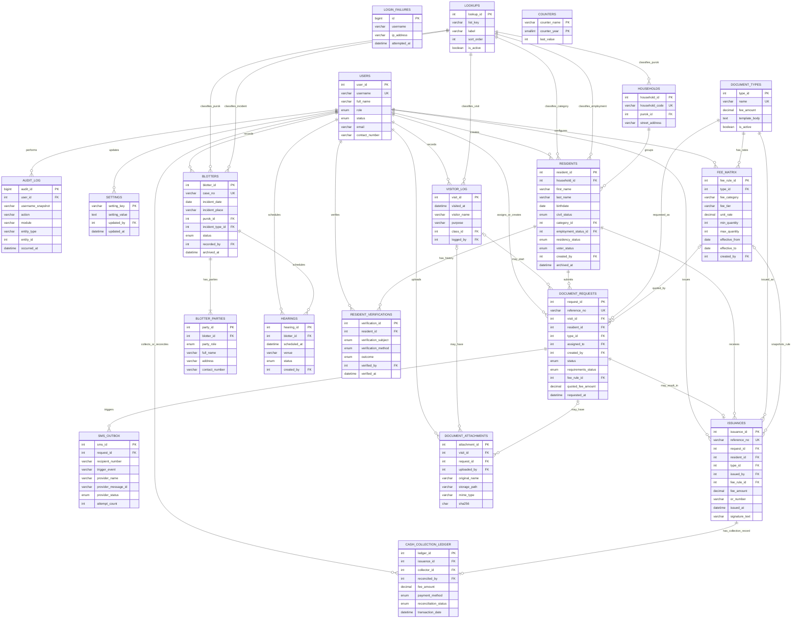
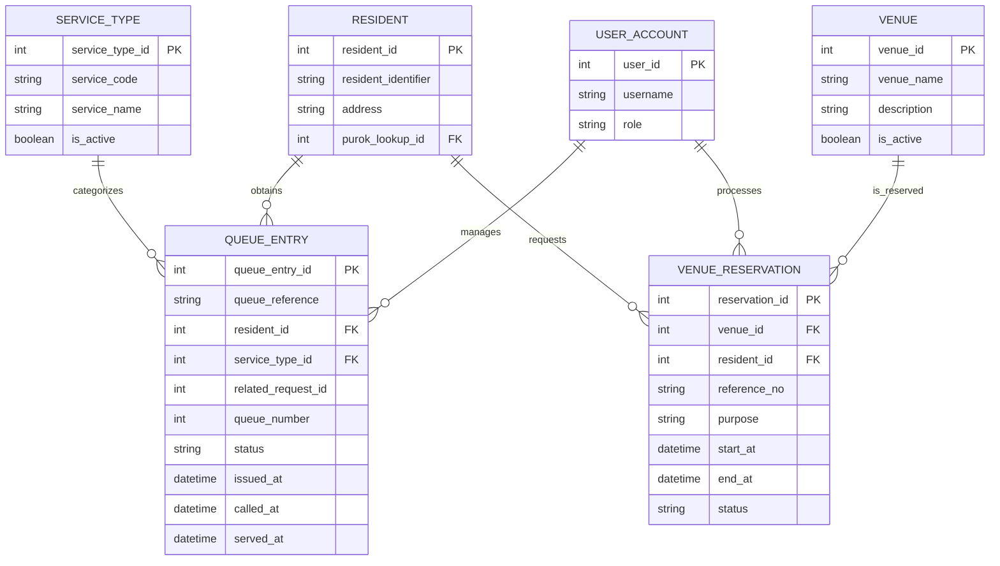

# BRMS Entity Relationship Diagram

**Repository baseline:** `main` database migrations 001–012  
**Purpose:** Show the schema that is actually created by the checked-in migrations, then identify the additional entities required by the revised SRS but not yet represented in those migrations.

> **Important:** This is not a claim that the current database fully implements the revised SRS. The current schema still contains the legacy `households` and `visitor_log` tables. The revised SRS changes resident grouping to Purok/address and replaces visitor logging with queueing. Queueing, venue and reservation tables were not found in migrations 001–012.

## 1. Existing database ERD (implemented migrations)

The diagram below reflects the tables and foreign-key relationships in `database/migrations/001_core.sql` through `012_sms_provider.sql`. Columns are intentionally limited to primary keys, foreign keys and the main business attributes so the diagram remains readable.

### Schema interpretation notes

- `LOOKUPS` is a shared reference table. Its `list_key` distinguishes values such as Purok, resident category, employment status, visit class and incident type.
- `HOUSEHOLDS` is still a real table in the current migrations, and `RESIDENTS.household_id` still references it. The revised SRS says to use address and Purok rather than household grouping. This is a schema/SRS mismatch that needs a migration and code update; do not simply relabel this table in the diagram.
- `VISITOR_LOG` still exists, and both document requests and attachments can reference it. The revised SRS removes the visitor logbook and replaces it with queueing. A safe transition needs to preserve historical visitor-linked requests/attachments while removing visitor intake from the new workflow.
- `BLOTTERS.purok_id` references `LOOKUPS.lookup_id`; there is no separate Purok table in the current schema.
- The current migrations do not define dedicated queue-entry, venue, or venue-reservation tables.
- `DOCUMENT_REQUESTS` stores the request status and requirements review; `ISSUANCES` is a separate permanent issuance snapshot.
- The cash ledger is one-to-one with an issuance because `cash_collection_ledger.issuance_id` is unique.
- The schema's current blotter status enum is not identical to the revised SRS status list. The revised status lifecycle must be reconciled with application code and migrations.

## 2. Revised-SRS conceptual additions (not yet present in migrations 001–012)

The following is a **proposed target model only** for the revised SRS requirements. It is intentionally separate from the implemented ERD above. These entities must not be presented as existing database tables until the team adds and tests their migrations.

This target model is conceptual: field names and keys must be confirmed during detailed design. The SRS describes three separate service queues (Documents, Blotter, Venue), queue number lifecycle actions (call next, served, skip, cancel), and venue reservations with overlap prevention. The existing schema does not yet store those records.

## 3. Requirements-to-schema gap checklist

| Revised SRS requirement | Evidence in migrations 001–012 | ERD / implementation action |
|---|---|---|
| Resident grouped by Purok and address; no household grouping | `households` and `residents.household_id` remain | Design a backward-compatible migration to store address and Purok directly or through an approved address model; migrate existing resident data and preserve history. |
| Resident status values Active, Transferred, Deceased, Non-resident | Current `residency_status` is only Active/Relocated | Align enum/reference data and all forms, filters, reports and tests. |
| Resident marital status | `civil_status` exists | Verify exact accepted values against revised SRS. |
| Resident types PWD, Senior Citizen, Solo Parent, 4Ps Beneficiary, Indigent, None | `category_id` points to shared `lookups` | Configure and validate approved values; no labels are seeded as official without approval. |
| Visitor logbook replaced by service queue | `visitor_log` remains; no queue table | Add queue persistence and service-specific numbering; retain legacy records for audit/history. |
| Queue display and staff call/serve/skip/cancel | No queue table in migrations 001–012 | Add queue status, timestamps, service key, number and actor/audit relationships. |
| Venue management and reservations | No venue/reservation tables | Add venues and reservations, with server-side overlap protection and status handling. |
| Request tracker for document, blotter and venue services | Document requests exist; no unified tracker entity for all service types | Define whether one generalized request table or linked service-specific records are intended; preserve document request compatibility. |
| Chairman stored e-signature automatically applied | Issuance has `captain_name` and `signature_text` snapshots; migration 011 describes typed signature text | Confirm whether an uploaded signature image/file is stored and applied in code. A typed name is not an image-based or cryptographically verified digital signature. |
| SMS/email queue and request notifications | SMS outbox/provider tracking exists; email delivery is not evidenced by these migrations | Verify application-level email/SMS delivery, provider configuration and fallback behavior separately. |

## 4. Sources inspected

- `database/migrations/001_core.sql`
- `database/migrations/002_settings.sql`
- `database/migrations/003_residents.sql`
- `database/migrations/004_requests.sql`
- `database/migrations/005_certificates.sql`
- `database/migrations/006_blotter.sql`
- `database/migrations/007_reporting_fields.sql`
- `database/migrations/008_request_requirements.sql`
- `database/migrations/009_fee_matrix_billing.sql`
- `database/migrations/010_resident_verification_log.sql`
- `database/migrations/011_document_attachments_cash_ledger_signature.sql`
- `database/migrations/012_sms_provider.sql`

