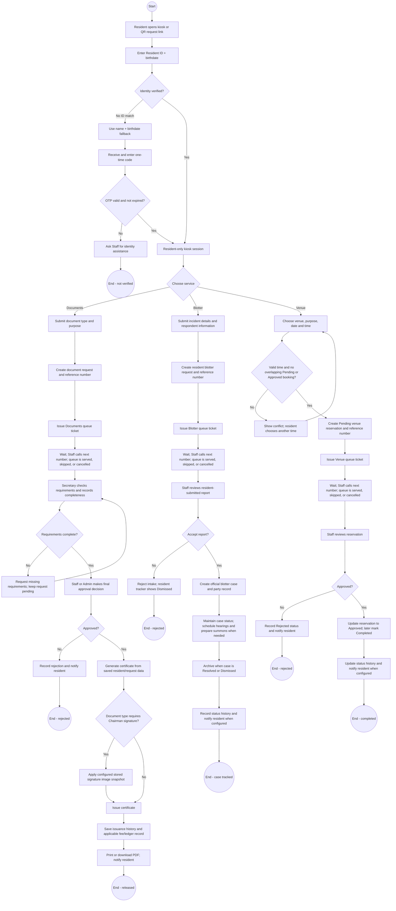
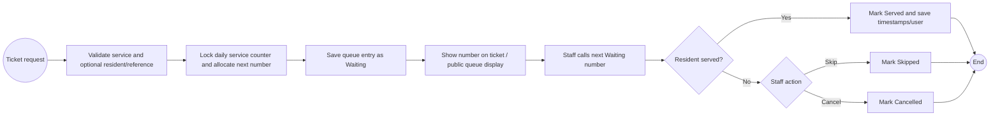

# BRMS Business Process Model and Notation (BPMN) — Verified Application Workflow

**Repository:** `sachie34/Birms`  
**Baseline branch:** `john/msit-srs-compliance`  
**Diagram branch:** `docs/brms-verified-bpmn-erd`  
**Implementation basis:** application routes/libraries, migrations `001–018`, role permissions, and repository verification notes.

> This is the workflow implemented by the selected compliance branch. It is not a diagram of every future requirement in the SRS. The diagram includes the resident kiosk, queue, document, blotter, venue, hearing, issuance, and notification flows present in the code.

## 1. Actors / BPMN lanes

| Lane / participant | Implemented responsibility |
|---|---|
| Resident | Identifies self at kiosk; submits document request, blotter report, venue reservation, or a standalone queue request; checks status using a reference number. |
| System | Validates identity/session, allocates references and queue numbers, checks reservation conflicts, stores status history, prepares certificates, and queues notifications. |
| Secretary | Reviews document requests and checks/records requirement completeness; maintains resident and case records within permissions. |
| Staff | Handles resident-facing service processing, final document decisions, certificate issuance, queue actions, blotter-request review, and venue reservation decisions. The code's internal role ID for Staff is `clerk`. |
| Administrator | Has administrative permissions across the system, including account/settings management and permitted service actions. |
| Chairman / Punong Barangay | Read-only application role. The Chairman's stored signature image is configured by Admin and automatically snapshotted onto document types that require it; Chairman does not process requests in the app. |

## 2. Overall resident service workflow

The diagram below uses BPMN-style start/end events, activities, and exclusive gateways. The formal BPMN 2.0 XML is also provided in `BRMS_VERIFIED_BPMN.bpmn`.

## 3. Queue lifecycle (shared by Blotter, Documents, and Venue)

Queue rules represented in code:
- Separate daily counters and ticket sequences exist for `Blotter`, `Documents`, and `Venue`.
- Queue statuses are `Waiting`, `Called`, `Served`, `Skipped`, and `Cancelled`.
- The queue service prevents calling another number while one number for that service/day remains in `Called` state.
- Staff can issue a walk-in ticket without a resident link; kiosk tickets are issued to the verified resident.
- Queue status changes and ticket issue/call actions are audited. Email/SMS notices are queued or attempted only when a channel/provider is configured.

## 4. Important data and status behavior

### Document request
- The database retains the internal workflow status values `Pending`, `Review`, `Ready`, `Claimed`, `Rejected`, and `Cancelled`.
- The revised public status field `msit_status` stores `Pending`, `Approved`, `Rejected`, or `Released`.
- The Secretary/Admin records requirement review. A final approve/reject action is blocked until requirements are marked `Complete`.
- The Staff/Admin role then makes the final decision. An approved request can proceed to certificate issuance; issuance history stores a snapshot of resident/document details and fee information.
- Certificate types have a `requires_chairman_signature` setting. If enabled, issuance requires the configured private Chairman signature image and snapshots the image path for that issuance. This is an image signature workflow, not a cryptographic digital signature.

### Blotter
- A resident-submitted report first exists in `resident_blotter_requests` with intake review status `Pending`, `Accepted`, or `Rejected`.
- Acceptance creates/links an official record in `blotters`; complainant/respondent records are held in `blotter_parties`.
- The revised case status is `Ongoing`, `Unresolved`, `Resolved`, `Dismissed`, or `Archived`. Hearing records are held in `hearings`.
- Resolved and dismissed cases are archived; official blotter deletion is blocked by a database trigger.

### Venue
- A reservation starts as `Pending`, then may become `Approved`, `Rejected`, or `Completed`.
- Overlap checking considers existing `Pending` and `Approved` reservations for the same venue/date/time. The application locks the venue row while creating a reservation to reduce concurrent double-booking risk.
- Venue availability can be automatic or manually overridden by Staff/Admin.

### Status tracking and notifications
- Residents can look up document, venue, resident-blotter, or official blotter references in the kiosk status page. Public lookup shows service/status/time and status history, not resident personal information.
- `request_status_history` records status changes for Documents, Blotter, and Venue.
- `notification_outbox` and `sms_outbox` store notification work. A queued/accepted message is not proof of successful delivery. Live delivery depends on correct provider credentials, account status, recipient contact details, and a real end-to-end test.

## 5. Roles shown in the workflow

| App role ID | Display role in revised SRS | BPMN responsibility |
|---|---|---|
| `admin` | Admin | User/settings administration and all permitted service actions. |
| `secretary` | Secretary | Resident/document/case records; document requirements review. |
| `clerk` | Staff | Resident-facing service processing, final request decisions, issuance, queue, blotter intake review, and venue actions. |
| `captain` | Chairman / Punong Barangay | View-only records/reports; stored signature is applied by the system to eligible certificates. |

The role labels above reflect the current `app/permissions.php` mapping in this branch. Final role policy should still be confirmed by the project owner/barangay.

## 6. Deliberate limits — do not overclaim

- Identity fallback depends on a configured email/SMS provider to deliver the one-time code. If delivery is not configured or fails, the resident is directed to Staff.
- SMS/email notices may remain queued, pending, or failed; the diagram shows the notification step, not guaranteed delivery.
- Resident ID/birthdate verification checks the local resident database. It is not a live COMELEC, PSA, or other government API lookup.
- Chairman signature is a stored image snapshot, not a cryptographic digital signature.
- Queue references and request references are associated in application logic; `queue_entries.reference_no` is not a database foreign key.
- Visitor log and household tables remain in the schema for legacy/compatibility workflows even though the revised SRS emphasizes kiosk/queue and direct resident address/Purok fields.

## Source files reviewed

- Kiosk: `public/kiosk/index.php`, `identify.php`, `verify.php`, `request.php`, `blotter.php`, `venue.php`, `queue.php`, `status.php`
- Queue: `app/queue_lib.php`, `public/queue/index.php`, `public/queue/action.php`
- Documents: `public/requests/action.php`, `app/requests_lib.php`, `app/certificates_lib.php`, `public/certificates/`
- Blotter: `app/blotter_requests_lib.php`, `app/blotters_lib.php`, `public/blotter_requests/`, `public/blotters/`
- Venues: `app/venues_lib.php`, `public/venues/`
- Notifications/signature/permissions: `app/notifications_lib.php`, `app/email_provider.php`, `app/sms_provider.php`, `app/signature_lib.php`, `app/permissions.php`
- Database: migrations `001–018`, `database/expected_schema.json`
