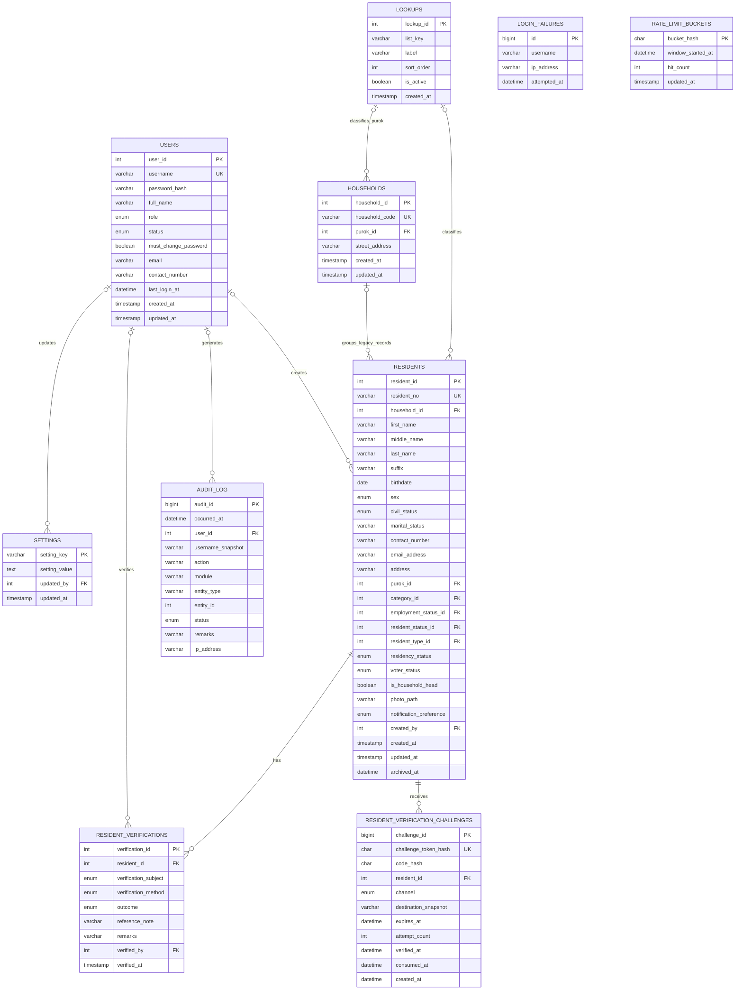
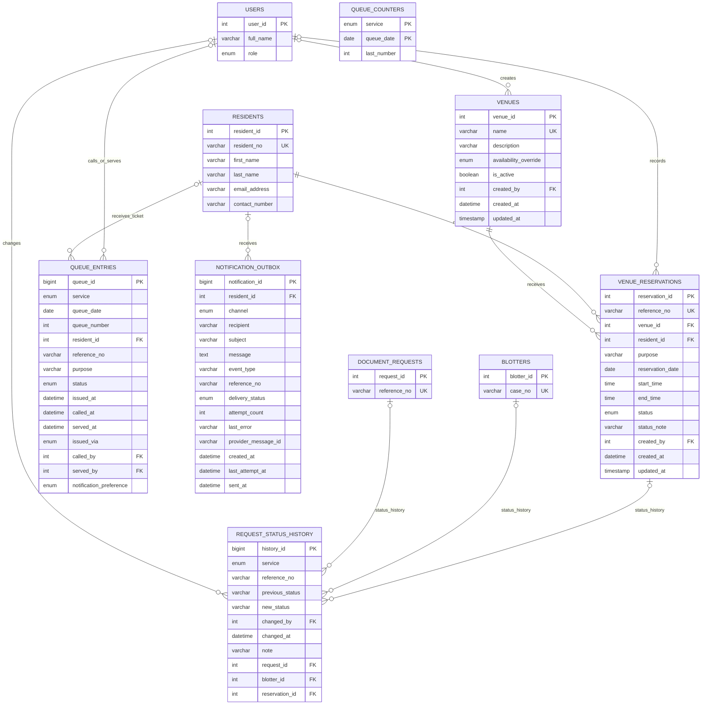

# BRMS Entity Relationship Diagram (ERD) — Verified Repository Schema

**Repository:** `sachie34/Birms`  
**Baseline branch:** `john/msit-srs-compliance`  
**Diagram branch:** `docs/brms-verified-bpmn-erd`  
**Schema basis:** migrations `001–018` (including both `016_*` migrations) and `database/expected_schema.json`.

> This ERD documents the database structure in the selected repository branch. It includes legacy tables and compatibility columns that still exist; it does not pretend those have already been removed. The diagrams are split by subject so the attributes remain readable.

## 1. Accounts, resident records, and reference data



**Important resident-model note:** the branch adds the revised direct resident fields (`address`, `purok_id`, `resident_status_id`, `resident_type_id`, `marital_status`, `resident_no`, and contact preferences), but retains `households`, `household_id`, `category_id`, `residency_status`, and `civil_status` for backward compatibility. Both sets are therefore shown because both exist in the schema.

## 2. Document requests, certificates, fees, and visitor attachments

```mermaid
erDiagram
    USERS {
        int user_id PK
        varchar username
        varchar full_name
        enum role
    }
    RESIDENTS {
        int resident_id PK
        varchar resident_no UK
        varchar first_name
        varchar last_name
        varchar contact_number
        varchar email_address
    }
    VISITOR_LOG {
        int visit_id PK
        datetime visited_at
        varchar visitor_name
        varchar purpose
        int class_id FK
        int logged_by FK
        timestamp created_at
    }
    DOCUMENT_TYPES {
        int type_id PK
        varchar name UK
        decimal fee_amount
        text template_body
        boolean is_active
        boolean requires_chairman_signature
        int sort_order
    }
    FEE_MATRIX {
        int fee_rule_id PK
        int type_id FK
        varchar fee_category
        varchar fee_tier
        decimal unit_rate
        int min_quantity
        int max_quantity
        date effective_from
        date effective_to
        boolean is_active
        int created_by FK
        timestamp created_at
    }
    DOCUMENT_REQUESTS {
        int request_id PK
        varchar reference_no UK
        int visit_id FK
        int resident_id FK
        int type_id FK
        varchar purpose
        enum status
        varchar status_note
        enum requirements_status
        varchar requirements_note
        int fee_rule_id FK
        varchar fee_category_snapshot
        varchar fee_tier_snapshot
        int fee_quantity
        decimal fee_unit_rate
        decimal quoted_fee_amount
        enum msit_status
        int assigned_to FK
        datetime requested_at
        int created_by FK
        timestamp updated_at
    }
    DOCUMENT_ATTACHMENTS {
        int attachment_id PK
        int visit_id FK
        int request_id FK
        varchar original_name
        varchar storage_path
        varchar mime_type
        int byte_size
        char sha256
        int uploaded_by FK
        datetime uploaded_at
    }
    ISSUANCES {
        int issuance_id PK
        varchar reference_no UK
        int request_id FK_UK
        int resident_id FK
        int type_id FK
        varchar resident_name
        varchar type_name
        varchar purpose
        decimal fee_amount
        int fee_rule_id FK
        varchar fee_category_snapshot
        varchar fee_tier_snapshot
        int fee_quantity
        decimal fee_unit_rate
        varchar or_number UK
        text body_text
        varchar captain_name
        varchar signature_text
        varchar chairman_signature_path
        int issued_by FK
        varchar issued_by_name
        datetime issued_at
        int print_count
        datetime last_printed_at
    }
    CASH_COLLECTION_LEDGER {
        int ledger_id PK
        int issuance_id FK_UK
        datetime transaction_date
        varchar requester_name
        decimal fee_amount
        enum payment_method
        int collector_id FK
        varchar collector_name
        enum reconciliation_status
        int reconciled_by FK
        datetime reconciled_at
        varchar notes
        timestamp created_at
        timestamp updated_at
    }
    SMS_OUTBOX {
        int sms_id PK
        datetime created_at
        varchar recipient_number
        varchar message
        varchar trigger_event
        int request_id FK
        int hearing_id
        enum delivery
        varchar provider_name
        varchar provider_message_id
        enum provider_status
        varchar provider_error
        int attempt_count
        datetime last_attempt_at
        timestamp updated_at
    }
    COUNTERS {
        varchar counter_name PK
        int counter_year PK
        int last_value
    }
    LOOKUPS {
        int lookup_id PK
        varchar list_key
        varchar label
    }

    USERS o|--o{ VISITOR_LOG : records
    LOOKUPS o|--o{ VISITOR_LOG : classifies
    USERS o|--o{ DOCUMENT_REQUESTS : creates_or_assigned
    RESIDENTS ||--o{ DOCUMENT_REQUESTS : requests
    DOCUMENT_TYPES ||--o{ DOCUMENT_REQUESTS : requested_type
    VISITOR_LOG o|--o{ DOCUMENT_REQUESTS : optional_intake_link
    DOCUMENT_TYPES ||--o{ FEE_MATRIX : has_fee_rules
    USERS o|--o{ FEE_MATRIX : configures
    FEE_MATRIX o|--o{ DOCUMENT_REQUESTS : optional_fee_rule
    DOCUMENT_REQUESTS ||--o| ISSUANCES : may_produce_one_issuance
    RESIDENTS ||--o{ ISSUANCES : receives
    DOCUMENT_TYPES ||--o{ ISSUANCES : issued_type
    USERS o|--o{ ISSUANCES : issues
    FEE_MATRIX o|--o{ ISSUANCES : optional_fee_snapshot_source
    ISSUANCES ||--o| CASH_COLLECTION_LEDGER : may_have_one_ledger_entry
    USERS o|--o{ CASH_COLLECTION_LEDGER : collects_or_reconciles
    DOCUMENT_REQUESTS o|--o{ DOCUMENT_ATTACHMENTS : has_files
    VISITOR_LOG o|--o{ DOCUMENT_ATTACHMENTS : may_have_files
    USERS o|--o{ DOCUMENT_ATTACHMENTS : uploads
    DOCUMENT_REQUESTS o|--o{ SMS_OUTBOX : may_trigger_sms
```

**Document workflow data notes:**
- A request has one resident and one document type. An issuance references one request; `issuances.request_id` is unique, so a request can produce at most one issuance row.
- A cash-ledger row is optional and unique per issuance.
- Attachments can be linked to a visitor entry, a document request, or both nullable links as stored.
- `sms_outbox.hearing_id` is a stored identifier in the schema but has no declared foreign-key constraint in the migrations/expected schema.

## 3. Blotter reports, cases, parties, and hearings

```mermaid
erDiagram
    USERS {
        int user_id PK
        varchar full_name
        enum role
    }
    RESIDENTS {
        int resident_id PK
        varchar resident_no UK
        varchar first_name
        varchar last_name
    }
    LOOKUPS {
        int lookup_id PK
        varchar list_key
        varchar label
    }
    RESIDENT_BLOTTER_REQUESTS {
        int request_id PK
        varchar reference_no UK
        int resident_id FK
        date incident_date
        time incident_time
        varchar incident_place
        int purok_id FK
        int incident_type_id FK
        text narrative
        varchar respondent_name
        int respondent_age
        varchar respondent_address
        varchar respondent_contact
        enum review_status
        enum msit_status
        varchar status_note
        int blotter_id FK_UK
        int reviewed_by FK
        datetime submitted_at
        datetime reviewed_at
    }
    BLOTTERS {
        int blotter_id PK
        varchar case_no UK
        date incident_date
        time incident_time
        varchar incident_place
        int purok_id FK
        int incident_type_id FK
        text narrative
        enum status
        enum msit_status
        enum archived_from_status
        varchar resolution_note
        datetime resolved_at
        datetime archived_at
        datetime recorded_at
        int recorded_by FK
        timestamp updated_at
    }
    BLOTTER_PARTIES {
        int party_id PK
        int blotter_id FK
        enum party_role
        varchar full_name
        int age
        varchar address
        varchar contact_number
        timestamp created_at
    }
    HEARINGS {
        int hearing_id PK
        int blotter_id FK
        datetime scheduled_at
        varchar venue
        varchar notes
        enum status
        varchar status_note
        int summons_count
        int created_by FK
        timestamp created_at
        timestamp updated_at
    }

    RESIDENTS ||--o{ RESIDENT_BLOTTER_REQUESTS : submits
    LOOKUPS o|--o{ RESIDENT_BLOTTER_REQUESTS : classifies_purok_and_incident
    USERS o|--o{ RESIDENT_BLOTTER_REQUESTS : reviews
    RESIDENT_BLOTTER_REQUESTS o|--o| BLOTTERS : accepted_request_creates_case
    LOOKUPS o|--o{ BLOTTERS : classifies_purok_and_incident
    USERS o|--o{ BLOTTERS : records
    BLOTTERS ||--o{ BLOTTER_PARTIES : has_parties
    BLOTTERS ||--o{ HEARINGS : schedules
    USERS o|--o{ HEARINGS : creates
```

**Blotter lifecycle note:** resident-submitted reports have an intake review status (`Pending/Accepted/Rejected`) separate from the resident-facing case status (`Ongoing/Unresolved/Resolved/Dismissed/Archived`). An accepted request can be linked to one official case. The database also retains the older blotter `status` column for compatibility. A database trigger blocks deleting official blotter cases.

## 4. Queues, venue reservations, notifications, and shared request history



**Queue and shared-history relationship limits (important):**
- `queue_counters` uses a composite primary key (`service`, `queue_date`) to allocate independent daily numbers. It has no declared foreign key to `queue_entries`.
- `queue_entries.reference_no` is a polymorphic service reference (Documents, Blotter, or Venue); it deliberately has no single FK because it may refer to different service tables.
- `request_status_history` has nullable FKs to the document request, official blotter case, and venue reservation. The `service` and `reference_no` identify the relevant service record.
- `login_failures` and `rate_limit_buckets` are independent security-support tables. `counters` stores named yearly sequences. They are included in the first two diagrams / schema inventory, not connected to business entities by FKs.

## Cardinality legend

- `||` = exactly one; `o|` = zero or one; `|{` = one or many; `o{` = zero or many.
- Relationships above are based on declared foreign keys and unique constraints. A line is not drawn where the schema has no FK, even if application code associates records by a reference number.

## Complete schema inventory

`users`, `login_failures`, `audit_log`, `settings`, `lookups`, `document_types`, `counters`, `households`, `residents`, `visitor_log`, `document_requests`, `sms_outbox`, `issuances`, `blotters`, `blotter_parties`, `hearings`, `fee_matrix`, `resident_verifications`, `document_attachments`, `cash_collection_ledger`, `venues`, `venue_reservations`, `queue_counters`, `queue_entries`, `request_status_history`, `resident_verification_challenges`, `notification_outbox`, `rate_limit_buckets`, and `resident_blotter_requests`.

## Source files reviewed

- `database/migrations/001_core.sql` through `012_sms_provider.sql`
- `database/migrations/013_hearing_concurrency.sql`
- `database/migrations/014_rate_limits.sql`
- `database/migrations/015_msit_srs_foundation.sql`
- `database/migrations/016_chairman_signature_requirement.sql`
- `database/migrations/016_msit_blotter_time_queue_purpose.sql`
- `database/migrations/017_resident_blotter_requests.sql`
- `database/migrations/018_blotter_no_delete.sql`
- `database/expected_schema.json`
